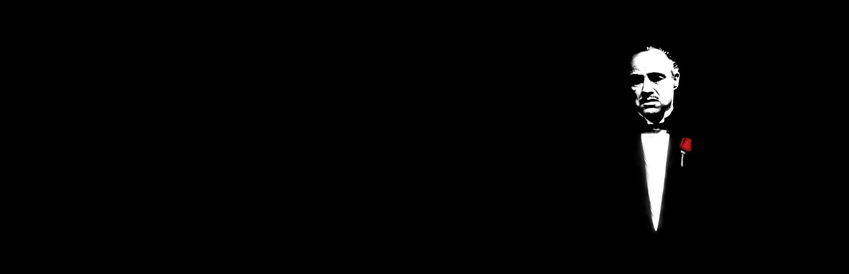

# The Godfather for Nintendo Switch

This project is a static recompilation port of *The Godfather* (original Xbox) for the Nintendo Switch, based on the static recompilation architecture and runtime framework.

The target executable is the **North American (USA / NTSC-U)** original Xbox release (XBE title ID `4541007D`).

> **Disclaimer:** This repository does NOT contain the game, its assets, binaries, or copyrighted code. You must provide your own legally obtained Xbox game dump.

---

## 🎮 Current Status & Performance

* **Status:** **PLAYABLE** on Nintendo Switch!
* **Recompilation:** All x86 execution partitions generated, verified, and running smoothly.
* **Graphics & Performance:** Rendered using Deko3D targeting stable gameplay.
* **Audio & Controls:** Game logic, audio, and controller input mapped and functional.
* **Tested Clocks (Handheld):** Tested on stock handheld clocks (**CPU 1020 MHz**, **GPU 307 MHz**, **RAM 1333 MHz**).
* **Overclock Recommendation:** While functional at stock frequencies, enabling a minor CPU/GPU/RAM overclock (e.g., via Sys-CLK) is recommended for improved framerate stability during heavy scenes.

---

## 🕹️ Controls

| Switch | Xbox |
| :--- | :--- |
| **B / A / Y / X** | **A / B / X / Y** *(by position: the button the game shows sits where you press)* |
| **L / R** | **left / right trigger** |
| **ZL / ZR** | **white / black** |
| **+ / -** | **Start / Back** |
| **sticks, stick clicks** | **sticks, stick clicks** |

---

## 🛠️ Requirements & Setup

### For Users

1. A Nintendo Switch running **Atmosphère CFW**.
2. A legitimate dump of **The Godfather (USA / NTSC-U version)** for Original Xbox (extracted game data files).
3. The compiled `godfather.nro` and `godfather-settings.toml` binaries from the [Releases](https://github.com/CYBERPUNK20/godfather-nx/releases) page.

### Installation & Launch

1. Create a folder on your SD card: `/switch/godfather-nx/`
2. Place the following files inside `/switch/godfather-nx/`:
   * `godfather.nro`
   * `godfather-settings.toml`
   * `game/` *(directory containing your extracted original USA game assets)*
3. **Launch Method:**
   * Start it in **Title Mode** (hold **R** while starting any game and pick it in hbmenu, or use Sphaira / a forwarder).
   * *Note:* **Applet mode** (opening hbmenu via the Album) does **not** have enough memory and will fail/warn accordingly.

---

## 📜 Credits and Licensing

The runtime, hardware wrapper, and Switch graphics layer are derived from static recompilation projects including **street-nx** and upstream contributors.

See `LICENSE`, `LICENSES.txt`, `SDK-LICENSE.txt`, and `THIRD_PARTY.txt` for applicable licenses, notices, and legal details.